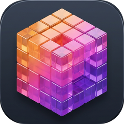
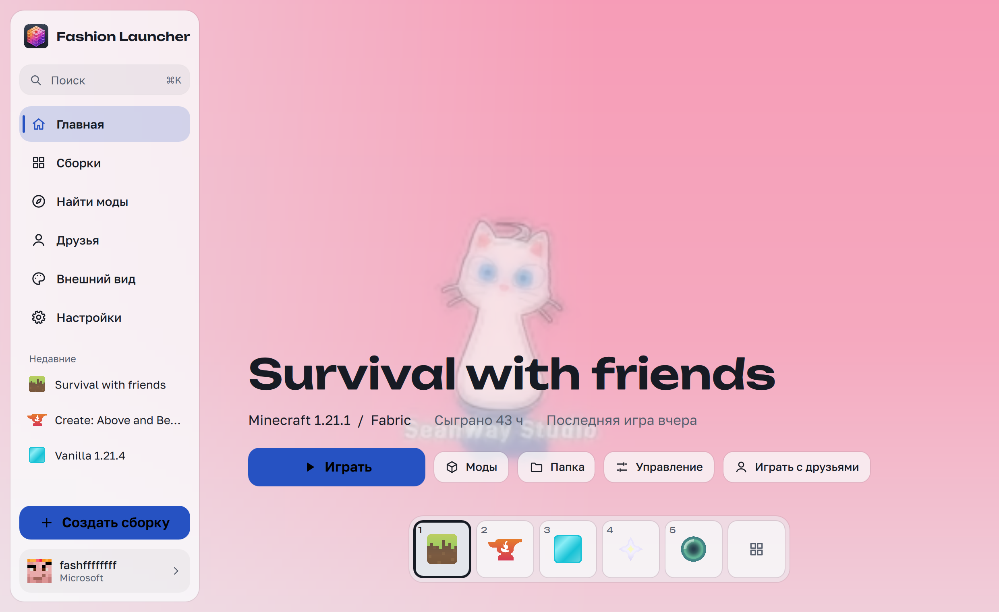
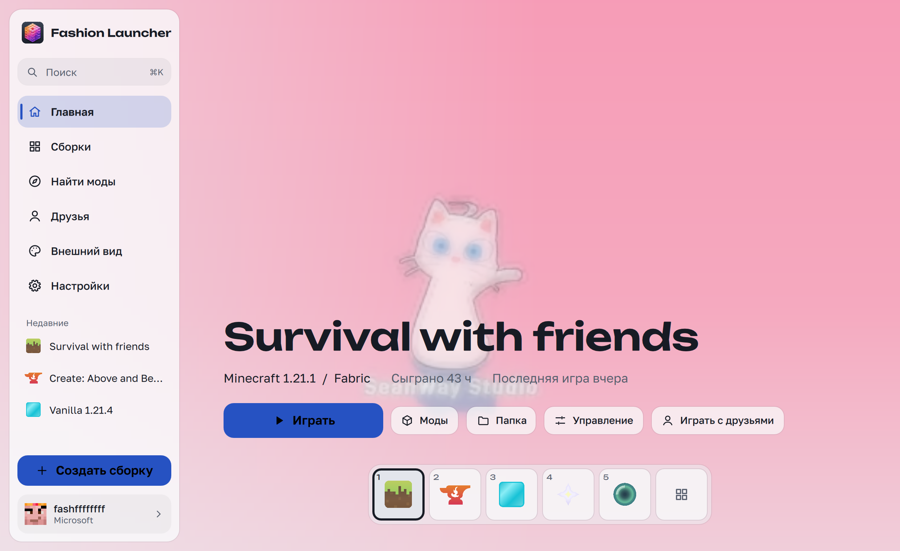
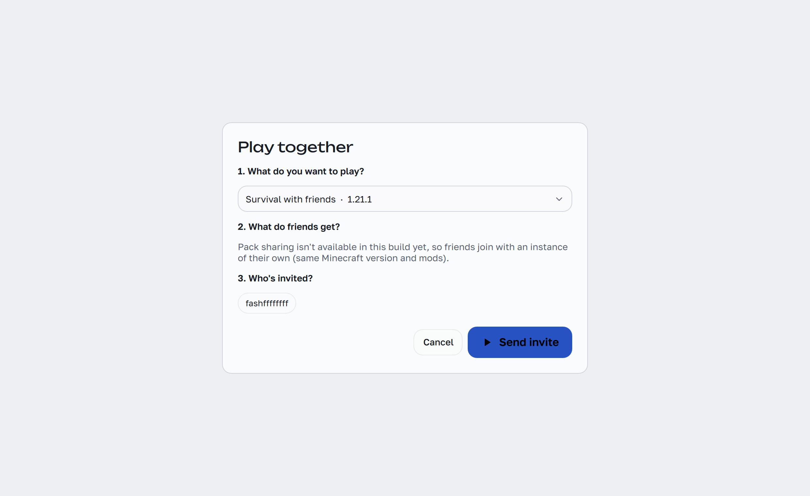
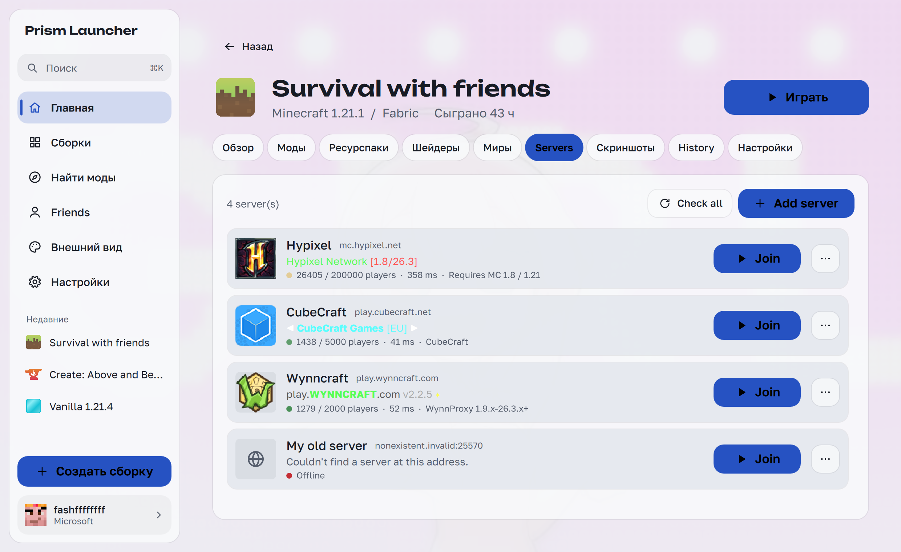
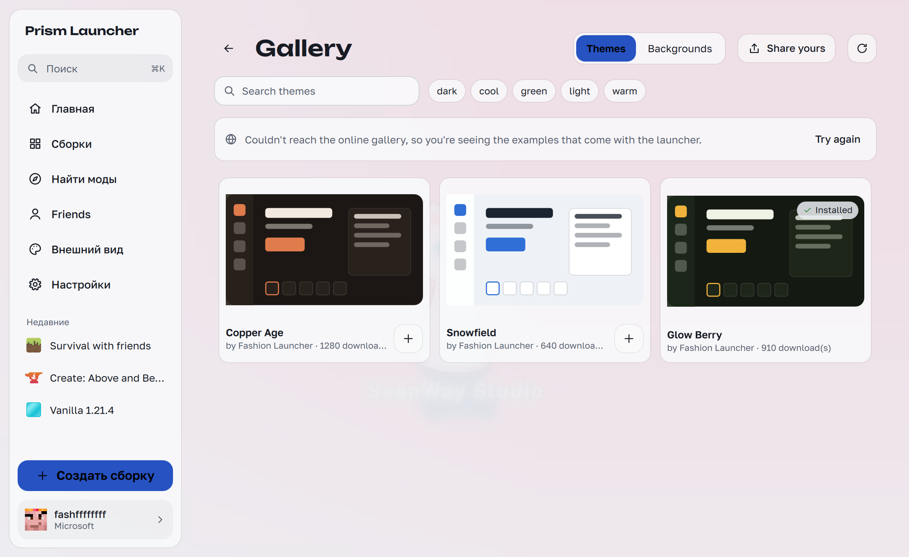

<p align="center">
  
</p>

<h1 align="center">Fashion Launcher</h1>

<p align="center">
  <b>Современный, стильный и мощный лаунчер для Minecraft с полностью новым интерфейсом на QML</b><br>
  Форк Prism Launcher с фокусом на визуальный стиль, удобство и игру с друзьями.
</p>

<p align="center">
  <a href="https://github.com/fashffffffff/fashionlauncher/releases"></a>
  
  
  
</p>

---

## ✨ Ключевые особенности

- 🎨 **Абсолютно новый QML-интерфейс** — плавный, адаптивный, с поддержкой динамических тем, анимированных шейдеров и живых панорам на фоне.
- 🔓 **Свободный вход** — полноценная поддержка как официальных аккаунтов **Microsoft (MSA)**, так и **офлайн-аккаунтов** без необходимости обязательной лицензии.
- 🌐 **Встроенный P2P мультиплеер (Play Together)** — серверless-подключение к мирам друзей через защищённый DHT/QUIC sidecar (`fashion-net`) на Rust. Никаких Hamachi, Radmin или проброса портов!
- 📦 **Каталоги Modrinth & CurseForge** — поиск, скачивание и автообновление модов, ресурспаков, датапаков и шейдеров в пару кликов.
- 💾 **Умное хранилище (Hardlink Store) и Снимки** — создание мгновенных точек восстановления сборок и откат изменений без дублирования файлов и траты места на SSD.
- 👕 **3D просмотр скинов** — встроенный интерактивный 3D-просмотр скинов и плащей прямо в карточке игрока.
- ⚡ **Низкое потребление RAM** — режим умной выгрузки интерфейса (`unloadShellForGame`) освобождает память во время игры, оставляя ресурсы для Minecraft.
- 🇷🇺 **Полная русская локализация** — весь интерфейс и подсказки аккуратно переведены на русский язык.

---

## 📸 Скриншоты

<p align="center">
  
</p>

<p align="center">
  
  
</p>

<p align="center">
  
  
</p>

---

## 📥 Скачать

Готовые релизы для всех поддерживаемых платформ доступны на странице [**Releases**](https://github.com/fashffffffff/fashionlauncher/releases):

| Платформа | Формат | Описание |
| :--- | :--- | :--- |
| 🍏 **macOS** | [`.dmg`](https://github.com/fashffffffff/fashionlauncher/releases) / [`.zip`](https://github.com/fashffffffff/fashionlauncher/releases) | Для Apple Silicon (M1/M2/M3/M4) и Intel (macOS 13.0+) |
| 🪟 **Windows** | [`.exe`](https://github.com/fashffffffff/fashionlauncher/releases) / [`.zip`](https://github.com/fashffffffff/fashionlauncher/releases) | Установщик (Setup) или портативная версия |
| 🐧 **Linux** | [`.AppImage`](https://github.com/fashffffffff/fashionlauncher/releases) / [`.tar.gz`](https://github.com/fashffffffff/fashionlauncher/releases) | Универсальный AppImage для любого дистрибутива |

---

## 🛠 Сборка из исходников

### Требования
- **CMake** $\ge$ 3.22
- **Компилятор C++20** (Clang, GCC или MSVC)
- **Qt 6** (Core, Gui, Widgets, Quick, Qml, QuickControls2, Quick3D, ShaderTools, Multimedia, NetworkAuth)
- **Rust / Cargo** (для сборки P2P sidecar `fashion-net`)
- **Java** 8 / 17 / 21 для запуска соответствующих версий Minecraft

### macOS
```bash
git clone --recursive https://github.com/fashffffffff/fashionlauncher.git
cd fashionlauncher
cmake -B build -DCMAKE_BUILD_TYPE=Release
cmake --build build -j$(sysctl -n hw.ncpu)
```

### Linux
```bash
git clone --recursive https://github.com/fashffffffff/fashionlauncher.git
cd fashionlauncher
cmake -B build -DCMAKE_BUILD_TYPE=Release
cmake --build build -j$(nproc)
```

### Windows
```powershell
git clone --recursive https://github.com/fashffffffff/fashionlauncher.git
cd fashionlauncher
cmake -B build -DCMAKE_BUILD_TYPE=Release
cmake --build build --config Release
```

---

## 📜 Лицензия

Fashion Launcher распространяется под лицензией **GPL-3.0**.  
Проект основан на кодовой базе [Prism Launcher](https://github.com/PrismLauncher/PrismLauncher), PolyMC и MultiMC.
